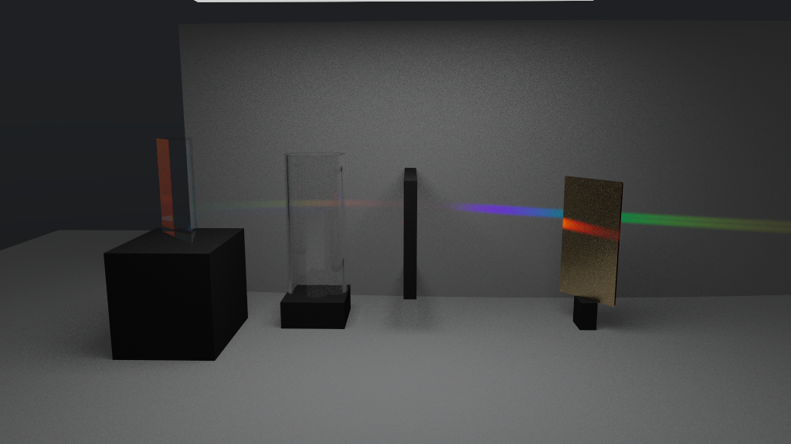

# 盐湖分光塔：C++17 光谱路径追踪器

一个只使用 C++17 标准库的 CPU 光谱渲染器。场景中的三棱镜、玻璃管、薄水层、
黄铜镜面、白色弧形墙、盐地、灯箱与相机全部由代码生成；渲染器不读取任何图像、
纹理或预生成彩虹图。



上图是 16 波段光谱积分后的 sRGB 结果。蓝绿波段穿过棱镜、玻璃管和水层后落在
白色弧形墙上；被玻璃管准直的红外/红光由倾斜黄铜镜接收，镜面反射呈现明显暖色偏。
`output/comparison_preview.png` 给出低/高采样与 RGB 近似的四宫格对照。

## 构建与运行

```bash
cmake -S . -B build -DCMAKE_BUILD_TYPE=Release
cmake --build build -j
./build/spectral_tower --output output --threads 20
# 或：./run.sh --output output --threads 20
```

默认正式渲染：

- `1024 x 576`，固定相机，39° 垂直视场；
- 低档 `8 spp/band + 40,000 hero photons/band`；
- 高档 `64 spp/band + 200,000 hero photons/band`；
- 16 个波段覆盖 `400-720 nm`，每段 20 nm；
- 在本机 20 线程环境约 170 秒完成两档。

快速烟雾测试：

```bash
./build/spectral_tower --quick --output /tmp/salt_lake_quick
```

参数可通过 `--width --height --low-spp --high-spp --low-photons
--high-photons --threads --max-depth --exposure --output` 调整。

## 场景与材质

- **三棱镜**：竖直角柱，25° 顶角的三角截面绕 y 轴旋转 -27.5°；使用高色散
  Cauchy 玻璃 `n(λ) = 1.2050 + 0.1085/λ²`（λ 以 µm 计），色散为观感略作夸张。
- **玻璃管**：闭合空心圆柱壳，内外表面都参与菲涅耳反射/透射与体内吸收。
- **薄水层**：竖直薄水盒，`n(λ)` 与弱吸收随波长变化。
- **黄铜镜面**：代码生成的倾斜矩形镜，使用复折射率表与复菲涅耳反射率，
  GGX 微表面粗糙度 `0.105`。
- **白色弧形墙**：40 m 半径的大圆弧三角网格，接收短/中波焦散。
- **盐地、基座、灯箱与窄光阑**：全部由解析几何或三角形网格生成。

## 16 波段光谱传输

每个波段保存独立辐亮度缓冲。主要光学模型：

- 可见光 16 段，区间 `[400,720] nm`，中心 `410,430,...,710 nm`。
- 介质使用非偏振 s/p 菲涅耳公式；全反射时只保留反射分支。
- 黄铜使用波长相关复折射率 `n(λ)+ik(λ)`，按复 Snell 定律计算导体菲涅耳响应。
- 每次进入玻璃/水后按光程应用 Beer-Lambert 吸收。
- 闭合棱镜和空心玻璃管都按真实入射/出射界面处理，不使用单一平面近似。

### Hero wavelength 采样

每个相机样本先以分层序列选出一个 hero 波段，然后同时追踪 16 个 companion
波段。所有 companion 共享：

- 同一相机光线和同一亚像素抖动；
- 同一随机流；
- 同一连续波段内波长抖动。

这样色散来自各波长不同的 IOR 和菲涅耳分支，但相机/几何采样保持同相，
显著降低光谱图像中的彩边噪声。光子端也使用同一 hero 源点、方向和随机序列，
因此不同波段的焦散不会因独立采样而错位。

### 双向前向传输

- 相机路径负责直接灯箱照明、玻璃/水层折射反射、黄铜 GGX 反射和背景。
- 窄光束从光源发出，沿真实波长相关路径穿过棱镜、玻璃管、水层，沉积到
  白色墙和黄铜镜的接收缓冲；焦散缓冲由实际光子能量投影生成。
- 焦散投影使用不透明深度缓冲遮挡，不把彩虹图案贴到棱镜或墙面上。

## RGB 近似与光谱积分

同一固定相机分别生成两种结果：

1. **RGB 近似**：在 620/545/460 nm 三条主波长上路径追踪，直接映射到 R/G/B。
2. **光谱积分**：用 16 波段辐亮度乘 CIE 1931 解析拟合色匹配函数，转 XYZ，
   再做等能白平衡和 sRGB 转换。两者使用相同固定曝光进行显示。

PFM 始终保存原始线性辐亮度；PPM 只对显示结果做相同 filmic tone map 与 sRGB
编码。

## 输出文件

```text
output/
  comparison.ppm                 2x2: 低/高采样 x 光谱/RGB 近似
  comparison_preview.png         由 PPM 生成的预览，不参与渲染
  validation.json                全部数值检查与通过状态
  summary.md                     可读的验证表和色散重心
  low/
    band_410nm.pfm ... band_710nm.pfm   16 个灰度 Pf 波段辐亮度
    spectral.ppm                 CIE 积分 sRGB
    rgb_approx.ppm               RGB 主波长近似
    caustic_only.ppm             窄光束接收器焦散 AOV
    energy_low.csv               每波段源/接收/吸收/逃逸能量与重心
    geometry_ids.pgm             主光线几何 ID
    opaque_depth.pfm             不透明深度
  high/                          同结构，高档采样
```

PFM 使用 little-endian float、行序自下而上；每个波段的 PFM 为单通道 `Pf`。
`energy_*.csv` 保留每个波长的源能量、墙/黄铜/地面接收能量、吸收、逃逸、
丢失能量以及能量加权命中重心。
逐波段账本闭合：`receiver + absorbed + escaped + lost` 与源能量之差小于
`1e-8`（每段源能量为 `1/16`）。

## 固定相机验证

相机位置 `(0.55, 2.95, 8.25)`，目标 `(0.35, 1.34, -0.55)`，
39° 垂直 FOV，低/高两档完全相同。

| 指标 | 低采样 | 高采样 |
|---|---:|---:|
| 每波段相机样本 | 8 | 64 |
| 每波段 hero 光子样本 | 40,000 | 200,000 |
| 渲染时间 | 25.77 s | 140.57 s |
| 白光接收总能量 | 0.570618 | 0.570610 |

通过项（来自 `output/validation.json`）：

- **波段能量收敛**：低/高图像能量最大相对差 `0.007%`；
  接收能量最大相对差 `0.674%`。
- **几何边缘无波长错位**：两档边缘哈希均为 `38d74aa739b0aebe`，
  5137 个几何边缘像素，错位像素 `0`。
- **色散存在**：16 波段接收器能量重心跨度 `x=2.9355 m, y=0.2024 m`。
- **无预生成彩虹贴图**：程序没有图像输入路径，棱镜分光是逐波长传输的结果。

### 光谱积分 vs RGB 近似

| 指标 | 光谱积分 | RGB 近似 |
|---|---:|---:|
| 白光接收总能量 | 0.570610 | 0.585535 |
| 图像亮度能量 | 24997.09 | 25577.58 |
| 黄铜镜面平均 R/B 比 | 2.2861 | 3.8888 |
| 三主色重心跨度 x | 16 波段见 `summary.md` | 0.4209 m |

RGB 近似的红、绿、蓝主波长会在玻璃管与水层中走不同的空间路径，尤其会放大
黄铜镜面的暖色偏；光谱积分则给出连续 16 波段能量积分结果。两者的固定相机、
分辨率、曝光和几何完全一致。

## 代码结构

```text
src/vec3.hpp       向量、采样、RNG、求根
src/spectrum.hpp   16 波段、IOR、复菲涅耳、CIE/sRGB
src/scene.hpp      相机、材质、解析/网格几何声明
src/scene.cpp      场景构造、求交、深度遮挡
src/renderer.hpp   采样参数、统计、输出接口
src/renderer.cpp   光子/相机路径、焦散投影、PPM/PFM
src/main.cpp       双档渲染、RGB 对照、验证报告
```

## 复现检查

```bash
./build/spectral_tower --output output --threads 20
python3 - <<'PY'
import json
v = json.load(open("output/validation.json"))
print(v["checks"])
PY
```

所有渲染与验证数值由 C++ 程序直接写出；Python 仅用于可选地查看 JSON。
